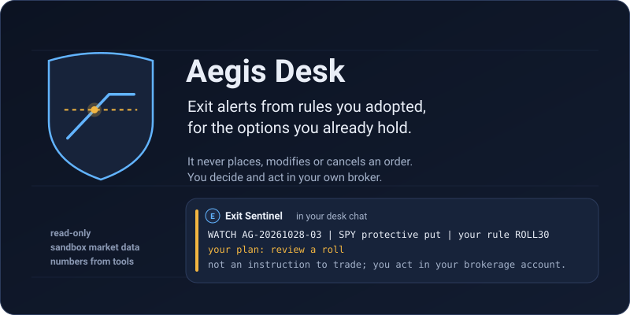
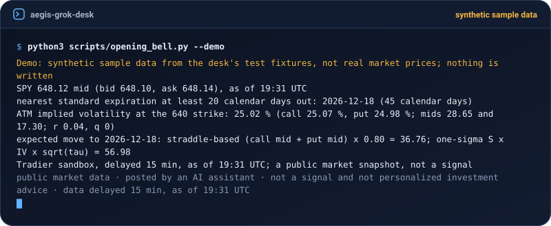
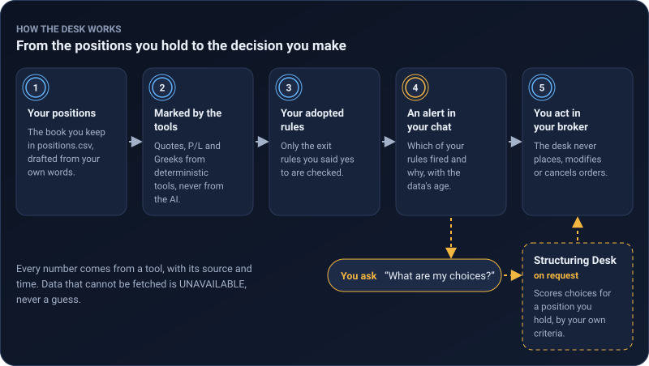

<p align="center">
  <picture>
    <source media="(max-width: 600px)" srcset="assets/hero-mobile.svg">
    
  </picture>
</p>

<p align="center">
  <a href="https://github.com/fairgradient-ai/aegis-grok-desk/releases"></a>
  <a href="LICENSE"></a>
  <a href="https://github.com/fairgradient-ai/aegis-grok-desk/actions/workflows/ci.yml"></a>
</p>

<p align="center">Works in <a href="#start">Grok Bot</a> · <a href="docs/aegis-claude-code.md">Claude Code</a> · <a href="docs/aegis-cursor.md">Cursor</a> · <a href="docs/aegis-codex.md">Codex</a> · <a href="docs/aegis-gemini-cli.md">Gemini CLI</a> · <a href="docs/aegis-grok-build.md">Grok Build</a></p>

Aegis Desk watches the option positions you already hold and tells you, in a chat, when one of your own rules is
met: take profits at half the premium, look at a roll before expiry week, and so on. Bots do the talking; small
Python tools compute every number.

This desk never places, modifies or cancels orders. An exit alert tells you which of your adopted rules fired and why; you act in your brokerage account.

## Try it now

```bash
git clone --depth 1 --branch v0.2.0 https://github.com/fairgradient-ai/aegis-grok-desk.git
cd aegis-grok-desk
python3 scripts/opening_bell.py --demo
```

It needs no account, no key and no install, only Python 3.9 or later. The data is a recorded, made-up sample, so
none of it is market data, and the command writes nothing.



## Start

Open Grok Bot, create a new Bot (it becomes your Aegis Desk Lead), and paste:

> Set up the Aegis options desk from https://github.com/fairgradient-ai/aegis-grok-desk/blob/v0.2.0/skills/aegis-desk-bootstrap-and-onboarding/SKILL.md. Follow that bootstrap skill and the runbook at https://github.com/fairgradient-ai/aegis-grok-desk/blob/v0.2.0/SETUP.md step by step, keep the desk read-only, and finish with the setup receipt.

It builds the desk, shows you a demo on a sample portfolio, and asks you for one thing: a free Alpaca paper key (a
key ID and its secret), added through the secure secret card, never pasted in chat. Alpaca's paper account is a
practice account that needs only an email address; its key brings in delayed market data
([how to get one](docs/FAQ.md#how-do-i-get-an-alpaca-paper-key)).

Then, when you want more, say these, starting with the first:

- **"add my positions"**: two safety settings, a few questions with suggested answers, and your positions told in
  your own words. Whichever phrase you say first, the safety settings and the questions come first.
- **"adopt my exit rules"**: keep the example rules, or change the ones you want.
- **"turn on monitoring"**: the daily checks and messages, on a schedule.
- **"set up the structuring desk"** (optional): your criteria, for when you ask "what are my choices?".

[SETUP.md](SETUP.md) is the full runbook the Bot follows.

## Meet the desk

| Bot | What it does for you |
| --- | --- |
| **Aegis Desk Lead** | Your main contact. Answers you or hands you to the right Bot, keeps the desk's settings, and sends a morning sheet and an end-of-day brief. |
| **Aegis Exit Sentinel** | Checks your positions against your rules four times a trading day and tells you when one is met, or when it cannot tell. |
| **Aegis Position Control** | Keeps your list of positions right: turns "I sold 2 calls" into exact lines for you to approve, and walks you through expiry week. |
| **Aegis Structuring Desk** | Only when you ask: prices your choices for a position you hold (close it, roll it, or add protection) and names the one your own criteria score best. |

All four sit together in one private group chat, the **Aegis Options Floor**. Every message starts from your
positions and delayed market data, and every number in it comes from a tool:

<p align="center">
  <picture>
    <source media="(max-width: 600px)" srcset="assets/desk-flow-mobile.svg">
    
  </picture>
</p>

## A day on the desk

**"How's my book?"** The Desk Lead quotes the profit-and-loss lines of the latest end-of-day brief, with its date.

**"What are my choices for the WMT call?"** The Structuring Desk runs a roll analysis of your short call. On the
sample portfolio it checks 20 replacement calls against your criteria and names the one that scores best, the
2027-01-15 115 call for a net credit of 0.05, with each leg's quote and the reasons. You supply the limit and act in
your broker.

**"I just sold 2 NVDA 20-Nov 150 calls at 3.20 against my 200 shares."** Position Control drafts the exact lines for
your positions file. You approve them; it saves them as approved and checks them.

**"Take profits at 60 % instead of 50 %."** The Desk Lead copies your rulebook, changes only that rule, shows you what
would change, and adopts it when you tap approve and type the phrase it gives you.

And without being asked: when a rule is met, the Exit Sentinel posts an alert. This one is from the sample portfolio
on its expiry day (wrapped here to fit a phone; the Bot posts it as one line):

```text
EXIT SIGNAL AG-20261020-01 | WMT covered call
| your rule TP80 (rules 1.0.0, sha cc09859c)
  fired: credit captured 95.32 % (your
  threshold: at or above 80 %); quote grade E:
  the conservative side stands
| already past this threshold at the desk's
  first observation
| quote grade E, Alpaca paper (IEX stocks,
  indicative options: approximate), 15-min
  delayed, as of 19:31 UTC
| your plan: close
| not an instruction to trade; you act in your
  brokerage account.
```

Once monitoring is on, a trading day looks like this (New York time):

| When | What you get |
| --- | --- |
| 07:30 | the morning sheet: is the desk healthy, open alerts, contracts expiring this week |
| 10:05, 12:05, 14:05 | a check of your rules; a message only when something changed |
| 15:35 | the last check and a one-line summary, always |
| 16:35 | each of your rules as the price at which it would fire, for your broker's own alerts |
| 17:10 | the end-of-day brief: profit and loss, alerts, which checks ran |

Silence between checks means nothing changed. [docs/MONITORING.md](docs/MONITORING.md) has the whole schedule.

## Controls

- **It never trades.** No tool here can send anything but a read-only market-data request, and no Bot holds a
  brokerage login. You act in your own brokerage account.
- **One credential, a practice one.** The only one is an Alpaca paper key, which cannot reach a live account. You
  add it through the secure secret card; it is never pasted in chat.
- **Every number comes from a tool,** with its source, its data delay and a UTC time. The Bots never do arithmetic.
- **"Cannot tell" is an answer.** Missing or stale data makes a rule UNAVAILABLE, never a quiet "all clear".
- **The rules are yours.** Only a rule you adopted can fire, every alert names that rule, and any change to your rules,
  settings or positions that you have not confirmed is flagged first.
- **Your tap is the signature.** Adopting rules, confirming a change and each answer of the Structuring Desk run only
  after you tap approve in Grok Bot.
- **It checks at intervals; it is not a live watcher.** The data is 15 minutes delayed, and the free option quotes are
  approximate (indicative, not exchange quotes), so set your broker's own alerts at the prices the desk gives you. No
  morning sheet by 08:00 ET on a trading day means the desk is not running.

How each control is enforced, and what it does not cover, is in [SECURITY.md](SECURITY.md).

## Runtimes

| Runtime | Setup |
| --- | --- |
| Grok Bot | the [Start](#start) prompt above; [docs/aegis-grok-bot.md](docs/aegis-grok-bot.md) |
| Claude Code | `/plugin marketplace add fairgradient-ai/aegis-grok-desk`, then `/plugin install aegis-desk@aegis-desk`; [docs/aegis-claude-code.md](docs/aegis-claude-code.md) |
| Grok Build | `grok plugin install fairgradient-ai/aegis-grok-desk@v0.2.0 --trust`; [docs/aegis-grok-build.md](docs/aegis-grok-build.md) |
| Cursor | open the pinned clone and enable the plugin; [docs/aegis-cursor.md](docs/aegis-cursor.md) |
| Codex | the marketplace entry; [docs/aegis-codex.md](docs/aegis-codex.md) |
| Gemini CLI | the extension; [docs/aegis-gemini-cli.md](docs/aegis-gemini-cli.md) |

Grok Bot runs the daily schedule. The other runtimes are for reading the desk and running its tools yourself.

## Inside the repository

```text
SETUP.md    the runbook a Grok Bot follows to build the desk
agents/     the four Bot profiles
skills/     the skills the Bots load
scripts/    standard-library Python tools and the repository gates
routines/   the daily schedule and the Auto-review rule texts
rules/      the desk rule and the example exit rules
hooks/      the broker-write gate for Claude Code, Grok Build and Cursor
template/   the Grok Bot template contract
assets/     the README pictures
tests/      the tests and the made-up sample desk
docs/       the pages below
```

| Doc | |
| --- | --- |
| [FAQ](docs/FAQ.md) | the paper key, the data delay, rules, positions, advice |
| [Monitoring](docs/MONITORING.md) | the schedule, what posts when, how to tell the desk is running |
| [Exit rules](docs/EXIT_RULES.md) | the rule language and how a rule changes |
| [Positions file](docs/POSITIONS_CSV.md) | the format of your positions |
| [Structuring Desk](docs/STRUCTURING.md) | criteria, answers and limits |
| [How it fits together](docs/ARCHITECTURE.md) | files, roles, trust boundaries |
| [Tool reference](docs/TOOLS.md) | every tool's flags and output, generated from the tools |
| [Skills index](skills/README.md) | every skill and who loads it |
| [Contributing](CONTRIBUTING.md) · [Security](SECURITY.md) · [Changelog](CHANGELOG.md) | |

## Help

- **Questions:** start with the [FAQ](docs/FAQ.md).
- **Bugs:** [open an issue](https://github.com/fairgradient-ai/aegis-grok-desk/issues) with the command and its
  output. Never include a key, an account number or your positions.
- **Security:** report privately, as [SECURITY.md](SECURITY.md) describes.
- **Updates:** watch the repository's [releases](https://github.com/fairgradient-ai/aegis-grok-desk/releases).

## License and credit

MIT licensed (FairGradient); see [LICENSE](LICENSE). Repository mechanics are adapted from
[HyperGrok Trading Desk](https://github.com/galleonlabs/hypergrok-trading-desk) by Andrew Wilkinson and Galleon Labs,
used under the MIT license; see [ATTRIBUTION.md](ATTRIBUTION.md). The roles, skills, rules, tools and pictures are
Aegis Desk's own.

Aegis Desk is documentation and tools, and its alerts are not personalized investment advice. The Structuring Desk's
answers are personalized suggestions computed from your own criteria; counsel review of their wording is pending
([docs/RELEASE.md](docs/RELEASE.md), step 4). Options involve substantial risk.
